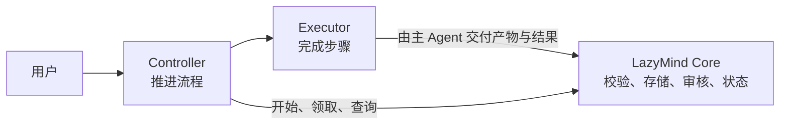
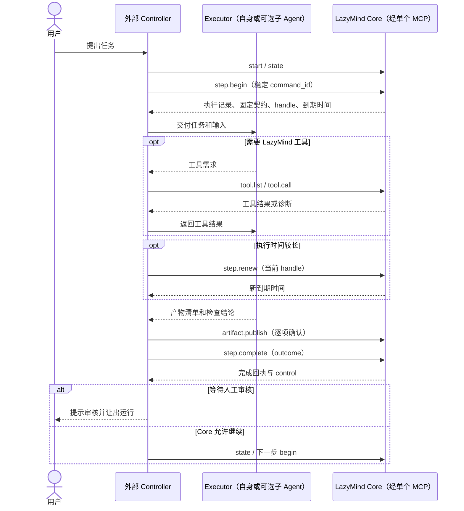

# 外部 Agent 与 Workflow 交互协议

外部模式中，Controller 和 Executor 均由外部 Agent 承担。LazyMind Core 创建执行任务，管理状态、授权、产物和审核；不因步骤声明了工具或检查而启动内部通用 Agent 模型。同一个步骤使用同一份业务契约。

## 角色与架构

| 角色 | 内部模式 | 外部模式 |
| --- | --- | --- |
| Controller | LazyMind Chat Agent | 外部主 Agent |
| Executor | Core 调度的内部执行器 | 外部主 Agent 自行执行，或宿主可选子 Agent |
| Core | 创建任务、授权、校验、结算和审核 | 同一职责；不管理外部父子会话关系 |
| 交付适配 | 内部 worker 上传并完成 | 外部主 Agent 代理工具调用、上传并完成 |

图中是逻辑角色。Controller 与 Executor 可以是同一个 Agent；子 Agent 不是接入前提。外部子 Agent 返回产物清单、文件或资源引用和简要检查结论，由主 Agent 交付 Core。主 Agent 持有 `execution_handle`，不把凭证或流程写权限交给子 Agent。

所有外部调用经**同一个 MCP 服务**进入。流程控制工具适配现有 Core 业务服务；通用工具复用注册目录和用户授权。图片、视频等专用模型可作为可选工具，由 Agent 在宿主能力不足时选择。外部运行无需配置 LazyMind 的通用 Agent LLM；选用专用模型工具时仍需该工具自身配置。

## 步骤契约与执行选择

Core 固定 Workflow revision，并返回公共 `step_contract`：

- `prompt`、`objective`、`launch_request`、`user_request`、`instruction`：业务任务与本次执行补充。
- `inputs`、输入类型和传输说明：固定输入及资源引用。
- `declared_outputs`、`required_outputs`、输出类型和数量约束：交付要求。
- `acceptance_criteria`、`capabilities`：质量要求与所需能力。

内外执行读取同一业务 prompt、验收和必需输出。内部工具执行标志属于内部适配，不向外部施加具体工具调用方式。Agent 自行选择满足契约的宿主能力或已授权 MCP 工具。

不再使用 `runtime.external_execution` 覆盖 prompt、验收或输出，也不要求 `scenario/external.md`。带旧覆盖层的包可继续接受内部编译；外部领取时返回 `WORKFLOW_REFACTOR_REQUIRED`，由开发者将业务要求整理到共用步骤后重新发布。框架不自动迁移包或替换运行中的 revision。

Core 校验权限、租约、输入输出、版本和存储一致性；语义、事实和视觉质量由所选 Executor 检查。原有大工具及步骤后检查中的模型工作由 Workflow 开发者拆解，不通过路由回内部 Agent 兜底。

## 一次步骤执行

Core 创建唯一执行记录及队列；是否委托子 Agent 不另建 Workflow 任务。子 Agent 的完成消息不代表 Core 已接受交付。已发布产物仍受现有事务输出和审核规则约束。

## MCP 与 Core 操作

| MCP 工具 | Core 职责 |
| --- | --- |
| `workflow.start` | 准备输入、创建固定 revision 的会话、绑定宿主 |
| `workflow.state` | 返回权威状态、可执行步骤和 `control` |
| `workflow.step.begin` | 复用推进服务创建执行，再领取执行契约 |
| `workflow.step.claim` | 领取已有执行；不创建下一次执行 |
| `workflow.step.resume` | 恢复同一次中断执行并更换 handle；旧 handle 失效 |
| `workflow.step.renew` | 在到期前延长当前租约；不恢复已过期授权 |
| `workflow.artifact.publish` | 保存真实产物；同一 slot/seq 的相同提交幂等 |
| `workflow.step.complete` | 校验已保存必需产物，原子结算状态、审核与回执 |
| `workflow.tool.list/call` | 发现注册工具、校验授权、保存调用回执；不自动发布产物 |
| `workflow.session.stop/resume` | 复用会话控制规则，停止失效或安排恢复 |

文件读取、资源传输、身份注入和 MCP 内容呈现属于适配层。推进条件、执行归属、输出检查和状态写入由 Core 维护。外部入口不再回退到旧 `advance-step-and-hand-off` 或旧合并 `submit` 协议。

## 回执与恢复

错误保持 `code`、`message`、`retryable`、`details`、`recovery`，经 HTTP 和 CLI 原样传到 MCP 的结构化错误。`retryable` 不能单独作为重试授权。

| 情况 | 返回信息与处理 |
| --- | --- |
| 步骤不就绪 | 保留缺失输入、可执行步骤、阻塞信息及相关投影；修复前置条件 |
| 缺产物 | `REQUIRED_OUTPUT_MISSING` 与 `details.missing_slots`；当前授权有效时补交后完成同一次执行 |
| 参数或文件不合法 | 返回可修正的输入错误；不标为可重试服务故障 |
| 授权变化或停止 | 读取最新状态；按 Core 允许的动作恢复，不继续使用旧 handle |
| start 成功、绑定失败 | 保留 session 和幂等 key，返回 `binding_required`；同一 start 重放完成绑定 |
| 写入成功、状态读取失败 | 保留创建/领取/完成回执，附 `state_unavailable`；读取原会话状态 |
| begin 成功、claim 未确认 | 保留执行 ID、命令回执和 `claim_required`；领取或恢复该执行，不能再创建一个 |
| 写请求响应丢失 | 标记结果未知，保留原命令标识；查询状态或重放同一命令 |
| 工具调用进行中或结果未知 | 保留原 `command_id`；不自动发起第二次付费操作 |
| `awaiting_user` | 正常等待，提示审核并让出运行，不自动批准或循环重试 |

相同命令的业务参数必须保持不变。Core 在重放已接受命令时返回原回执；状态版本用于第一次提交的并发检查，不让成功后的版本变化破坏重放。产物和完成调用沿用既有幂等规则。

## 会话绑定、取消与续租

- 保留现有 Connector 注册、真实宿主会话绑定、HostAction 投递和通知确认机制。通知仅用于唤醒，不是执行授权；收到后先读取最新 Core 状态。
- 人工审核通过现有用户入口进行；恢复不自动批准待审核结果。
- 主 Agent 负责在 `lease_expires_at` 之前续租；委托子 Agent 时也由主 Agent 续租。到期后停止提交，读取状态决定是否恢复。
- Core 停止、回退或替换授权后拒绝旧提交。宿主支持取消时，主 Agent/Connector 取消所属子任务；Core 已停止不等于远端计算已终止。
- 不新增外部子会话注册、子 Agent 直连权限或伪造内部 `SubAgentTask`。步骤进度上报、侧栏详情与面板适配另行处理。

接入细节见[外部工作流开发接入](../dev/external-workflow.md)。Workflow 包格式规范、生成指引和创作校验另行整理。
