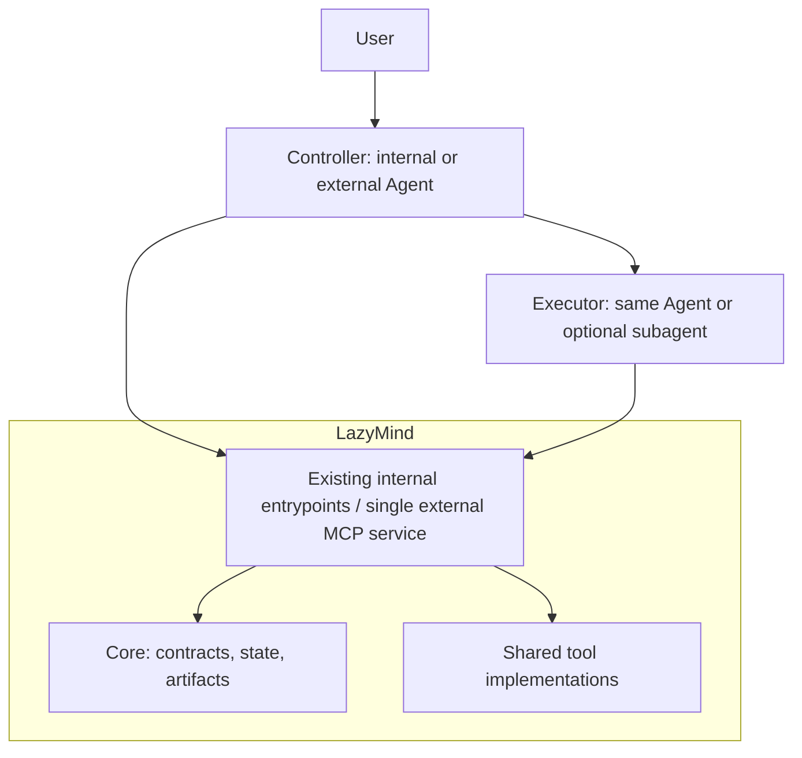

# Shared Workflow tools

LazyMind's L1/L2 tools are callable business operations shared by internal Agents
and external Agents. `algorithm/lazymind/toolkit/registry.py` adds their callables
to the ordinary Chat registry; the existing Core `tool.list` / `tool.call` gateway
uses that same registry. No second MCP server or synthetic subagent session is
required. An active Workflow can also use `workflow.tool.list` / `workflow.tool.call`.



The diagram shows roles. External calls reach tools and Core through the MCP
service; internal calls use the corresponding existing application entrypoints.
Tools return results. They do not advance steps, publish Workflow artifacts or
decide whether the Controller should create a subagent.

## Catalog and layers

The supported catalog has **29 L1 operations and 12 L2 operations**. These are
business operations, not 41 new top-level MCP tools. Twenty-eight entries use
the shared Python registry (including replacements for `url_fetch` and
`video_to_gif`); thirteen reuse existing Core or registered provider operations.
Other existing Chat tools are not included in this count.

| Layer | Group | Operations |
| --- | --- | --- |
| L1 | Resources | `resource.read`, `resource.search`, `document.parse`, `resource.images.extract` |
| L1 | Web | `web_search`, `url_fetch`, `image.search` |
| L1 | Knowledge | `knowledge.list`, `knowledge.document.list`, `knowledge.document.get`, `knowledge.search` |
| L1 | Cloud documents | `cloud_document.list`, `cloud_document.get`, `cloud_document.search`, `cloud_document.read` |
| L1 | GitHub | `github.pr.list`, `github.pr.read` |
| L1 | Special models | `image_generator`, `image_editor`, `video_generator` |
| L1 | Media processing | `image.inspect`, `image.caption`, `image.compose`, `video_to_gif` |
| L1 | Documents | `document.convert`, `document.export`, `document.patch.validate`, `document.patch.apply` |
| L1 | Arithmetic | `calculator` |
| L2 | Presentations | `presentation.inspect`, `presentation.fill`, `presentation.create`, `presentation.edit`, `presentation.render`, `presentation.export` |
| L2 | Academic sources | `academic.search`, `academic.read`, `academic.resolve`, `academic.relations.validate` |
| L2 | Data | `data.statistics`, `chart.render` |

For registered Python tools, use the `tool_id` returned by discovery, normally
`builtin:resource.read`, for example. Knowledge/cloud operations keep their
existing dedicated MCP interfaces and Core ownership checks.

L3 retains Workflow-specific prompts, routes, acceptance rules, slot bindings
and publication. Workflow authors choose and compose these public operations.
The registry never executes arbitrary code from a Workflow package.

## Files, identity and results

File parameters use a common `FileInput`:

```json
{"source": {"resource_id": "<owned immutable resource ID>"}}
```

Alternatively supply `name`, `content_base64` and optionally `sha256`,
`mime_type`, `size_bytes`. Returned `file` objects have the same fields and can
be passed directly to another tool. `resource_id` and inline bytes are mutually
exclusive. Core resolves IDs against the authenticated owner and checks content
integrity. A model cannot supply user identity, server paths or provider secrets.
Internal callers can pass the same inline file objects without a Workflow session.

Files are limited to 24 MiB each; combined inputs are limited to 24 MiB.
Office archives additionally have decompression limits. The tool transport
allows 36 MiB for base64 and JSON overhead; ordinary capability responses keep
their existing smaller bounds. Prefer resource IDs to repeatedly sending bytes.
Outputs are temporary bytes with hashes, not durable Workflow publications.
The Controller still explicitly imports/publishes desired results through Core.

GitHub collection reuses the existing PR collector and returns portable,
hash-checked source JSON files. Reading those files needs no conversation cache.
Existing Chat/PPT collection wrappers still use the same collector.

## Execution and model boundary

- Ordinary reasoning, writing and semantic/visual review belong to the Agent.
  L1/L2 deterministic tools never initialize an ordinary LLM to do that work.
- Image/video generation remain explicit, optional special-model operations.
  Existing per-user provider configuration and authorization apply. An external
  Agent may use its own equivalent capability instead.
- `knowledge.search` accepts `mode: "keyword"` for model-free exact phrase search
  or `"semantic"` (default) for configured embeddings and optional reranking.
  Both preserve knowledge/document authorization. Retrieval no longer rewrites
  queries using a hidden ordinary LLM.
- Web/academic search and connected GitHub calls use the existing configured
  providers. Public GitHub/arXiv reads are possible without model configuration.
- `url_fetch` returns PDF bytes rather than silently ingesting them into a Chat
  workspace. `document.parse` / `academic.read` extract text from those bytes;
  scanned PDFs explicitly report `OCR_REQUIRED`.

## Supported deterministic formats

- Parsing: UTF-8 text/Markdown, HTML, DOCX and text PDFs. Image extraction handles
  PDF embedded images or caller-specified regions; OCR is a separate capability.
- Documents: Markdown, LMD and Writer IR conversion; Markdown/text/LaTeX/LMD/IR
  and basic Markdown-to-DOCX export. DOCX supports text, headings, lists, tables,
  code and links; raw HTML and images require a different renderer. No cloud write
  occurs. Patch validation checks structure, exact targets and SHA-256 version,
  then application returns a new document. It is not semantic quality approval.
- Presentations: existing OOXML inspection, template slot filling, native slide
  creation, content/structure/layout/font edits, HTML rendering/export and PPTX
  page rendering. Rendering needs the existing PPT CLI/browser or LibreOffice.
  Offline HTML restrictions and explicit edit/version checks remain in force.
- Media: image metadata, text overlays and grid composition; GIF overlays retain
  frame timing and loop information. Video-to-GIF accepts MP4/MOV inputs and
  requires FFmpeg/FFprobe. Text overlays require fonts for the supplied script.
- Academic: provider search, full-text reading of supplied PDFs, DOI/arXiv syntax
  normalization and relation structure validation. Identifier normalization does
  not verify publication existence; relation validation does not assess claims.
  Private stored papers continue to use the authorized knowledge interfaces.
- Data: descriptive statistics, Welch's t-test and Pearson correlation; bar,
  line and scatter charts from explicit arrays. No generated programs execute.
  Advanced analysis/reporting remains Workflow composition work.

## Error recovery

Shared functions return controlled errors with `code`, `message`, `details`,
`retryable` and `recovery`. The HTTP adapter and Core preserve that information;
MCP maps transport codes while keeping the original code in `details.tool_code`.
Workflow calls preserve it in their existing failure receipts. Uncontrolled
provider exceptions remain sanitized.

For a version conflict, read the current file/document and rebuild the edit.
For invalid arguments, correct the returned field/target errors. For missing
OCR, renderer, font, FFmpeg or model dependencies, provide/configure the explicit
capability before retrying. Do not repeat unchanged invalid calls or treat a
structural validation result as business approval.
